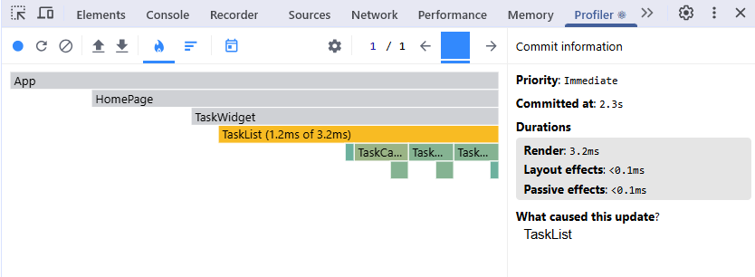
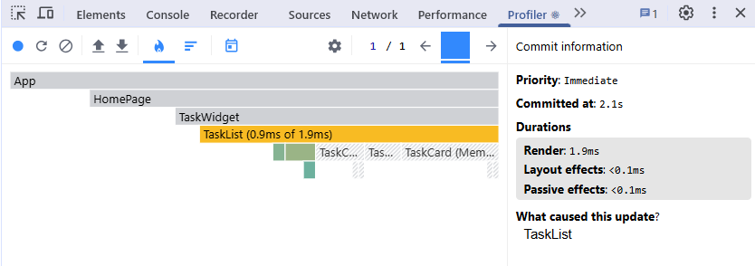

# HW 1

## DONE:

- Проект запускается без ошибок — 1 балл
- Структура соответствует FSD — 1 балл
- Настроены ESLint и Prettier с конфигурацией, отражающей принципы FSD — 1 балл
- Типизация и структура — 1 балл
- Компонент TaskCard с правильной презентационной логикой — 1 балл
- Стили через .module.css — 1 балл
- Хук useTasks корректно реализует фильтрацию и удаление — 1 балл
- Компонент TaskList правильно отображает отфильтрованные задачи — 1 балл
- Используется state-хук и проброс пропсов — 1 балл
- Страница и виджет работают корректно — 1 балл
- Читаемый, чистый и модульный код — 1 балл
- Вынести кнопку фильтрации в shared-компонент — 1 балл

# HW 2

## Работа с Profiler:

Удаление элемента списка до оптимизации:

Общее время рендера TaskList: 3.2 мс
Время рендера TaskList (активная часть): 1.2 мс
Количество перерисованных дочерних компонентов: Все TaskCard (зелёные блоки)

Удаление элемента списка после оптимизации:

Общее время рендера TaskList: 1.9 мс
Время рендера TaskList (активная часть): 0.9 мс
Количество перерисованных дочерних компонентов: Только один TaskCard (остальные заштрихованы как "Memo")

Вывод: Оптимизация позволила сократить время рендера и исключить ненужные перерисовки дочерних компонентов.

## DONE:

1. Оптимизация TaskCard с помощью React.memo

- Компонент TaskCard обернут в React.memo — 1 балл
- Поведение корректное, props не создаются заново — 1 балл
- Код читаемый и чистый — 1 балл

2. Мемоизация списка задач с useMemo

- useMemo применяется для фильтрации — 1 балл
- UI обновляется корректно — 1 балл
- Поведение не ломается — 1 балл

3. Мемоизация функций с useCallback

- Используется useCallback в useTasks — 1 балл
- Функции корректно передаются — 1 балл
- Поведение не ломается — 1 балл

Анализ производительности через DevTools

- Есть скриншот работы с Profiler — 1 балл
- Есть комментарии к скриншоту с пояснениями — 1 балл
- Есть анализ 2+ компонентов — 1 балл

# HW 3

## DONE:

- API корректно описан и экспортирует хук useGetTasksQuery — 1 балл
- Загрузка задач происходит без ошибок — 1 балл
- Используется transformResponse для получения массива — 1 балл
- Реализован хук useTasks,в котором данные загружаются через useGetTasksQuery — 1 балл;
- Задачи отображаются в интерфейсе — 1 балл
- Код структурирован и соответствует FSD — 1 балл
- Использован useEffect для загрузки данных в useState — 1 балл
- Реализована функция removeTask — 1 балл
- После удаления задача исчезает из UI — 1 балл
- baseApi создан и экспортирован из shared/api/baseApi.ts (или shares/...), tagTypes включает Tasks — 1 балл
- tasksApi использует injectEndpoints от baseApi; getTasks корректно возвращает Task[] — 1 балл
- в store подключены baseApi.reducer и baseApi.middleware один раз — 1 балл

# HW 4

## DONE:

- Использован один из рекомендованных подходов (Formik или RHF) — 1 балл
- Все поля формы обязательны для заполнения — 1 балл
- Реализована корректная валидация всех полей — 1 балл
- Ошибки отображаются рядом с соответствующими полями — 1 балл
- Использована схема валидации вместо ручной логики — 1 балл
- Сообщения об ошибках отображаются корректно рядом с соответствующими полями — 1 балл
- Использованы useFieldArray (в случае RHF) или FieldArray (Formik) — 1 балл
- Форма корректно обрабатывает массив ссылок — 1 балл
- Добавление и удаление работает без ошибок — 1 балл
- Каждое поле валидируется как URL — 1 балл

## NOT DONE:

- Реализована форма с использованием useActionState — 1 балл
- Сообщения об ошибках или успешной отправке отображаются в UI — 1 балл

# HW 5

## DONE:

1. Компонент ClickTimer

- Время первого клика фиксируется через ref — 1 балл
- Счетчик кликов хранится в ref, не вызывая ререндер — 1 балл
- В консоли отображается разница во времени и общее количество — 1 балл

2. Компонент PreviousInput

- Текущее значение отслеживается через onChange — 1 балл
- Предыдущее значение сохраняется через ref — 1 балл
- UI корректно отображает предыдущее значение — 1 балл

3. Компонент FocusTracker

- Установка фокуса работает через ref.current.focus() — 1 балл
- Переход фокуса отслеживается через onFocus — 1 балл
- Количество фокус-переходов корректно отображается в консоли — 1 балл

Компонент DebouncedLogger с useRef

- Используется setTimeout через ref — 0.5 балла
- Старый таймер корректно очищается — 0.5 балла
- Лог появляется только по истечении задержки — 0.5 балла

## NOT DONE:

Компонент WebSocketLogger

- Соединение хранится в ref, а не в state — 0.5 балла
- WebSocket создается один раз при монтировании — 0.5 балла
- Соединение корректно закрывается в cleanup — 0.5 балла
